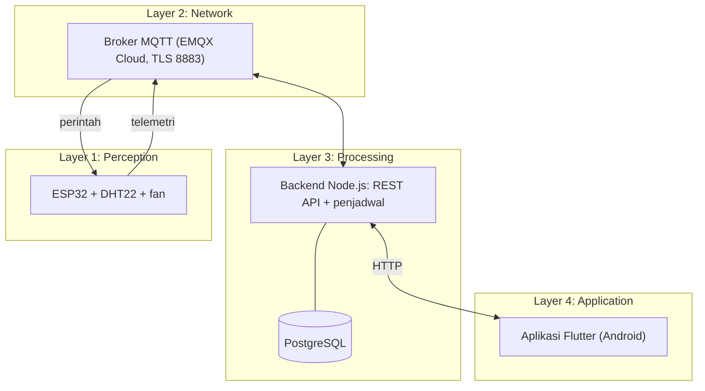

# Smart Humidity-Based Bathroom Exhaust Fan

Proyek IoT empat layer: exhaust fan kamar mandi yang menyala otomatis berdasarkan kelembapan udara, bisa dipantau dan dikendalikan dari aplikasi Android, serta menyimpan riwayat data untuk ditampilkan sebagai grafik.

> **Status saat ini:** Tahap 0 sampai 4 selesai. **Tahap 5 (Jadwal Standby) sedang dikerjakan**: database, API, penjadwal backend, dan firmware sudah jadi; layar Jadwal di aplikasi baru berisi daftar, sakelar aktif, dan hapus. Form tambah/ubah jadwal adalah langkah berikutnya. Lihat [Tahapan pengerjaan](#tahapan-pengerjaan).

---

## Daftar isi

1. [Arsitektur](#arsitektur)
2. [Fitur](#fitur)
3. [Teknologi](#teknologi)
4. [Struktur folder](#struktur-folder)
5. [Prasyarat](#prasyarat)
6. [Clone dan menjalankan](#clone-dan-menjalankan)
7. [Urutan menyalakan sistem](#urutan-menyalakan-sistem)
8. [Referensi MQTT dan API](#referensi-mqtt-dan-api)
9. [Aturan kontrol fan](#aturan-kontrol-fan)
10. [Tahapan pengerjaan](#tahapan-pengerjaan)
11. [Catatan keamanan](#catatan-keamanan)
12. [Pemecahan masalah](#pemecahan-masalah)

---

## Arsitektur

| Layer | Peran | Komponen |
|---|---|---|
| 1. Perception | Membaca kelembapan dan suhu, menggerakkan fan | ESP32, sensor DHT22, fan (di simulasi: LED) |
| 2. Network | Mengangkut data dan perintah | WiFi, MQTT (TLS), broker EMQX Cloud Serverless |
| 3. Processing | Menyimpan, mengolah, menyediakan data | Backend Node.js, PostgreSQL, penjadwal Standby |
| 4. Application | Menampilkan data dan menerima perintah | Aplikasi Android (Flutter) |



Data sensor mengalir naik dari Layer 1 ke Layer 4. Perintah pengguna mengalir turun dari Layer 4 ke Layer 1. Aplikasi **tidak** berbicara MQTT; ia hanya memanggil API backend.

## Fitur

- Pemantauan kelembapan, suhu, kecepatan fan, mode, dan status online/offline secara real-time.
- Animasi aliran udara di Dashboard: warna mengikuti kelembapan (biru nyaman, kuning waspada, oranye tinggi, merah kritis), kecepatan mengikuti kecepatan fan.
- Mode **Auto** (hysteresis dan post-run) dan **Manual** (slider kecepatan).
- Tombol **On/Off** daya (fan mati total).
- Grafik riwayat kelembapan dan kecepatan fan (1 jam, 24 jam, 7 hari) beserta ringkasan.
- **Jadwal Standby**: pada rentang waktu tertentu fan tidak menyala otomatis (kecuali kelembapan kritis). Penjadwalnya berjalan di backend (zona waktu WIB).
- Pengaman: kalau kiriman Standby dari backend berhenti selama 3 menit, firmware kembali ke Auto.

## Teknologi

| Bagian | Teknologi |
|---|---|
| Firmware | Arduino framework (C++), Wokwi untuk simulasi |
| Broker | EMQX Cloud Serverless (MQTT di atas TLS) |
| Backend | Node.js, Express, `mqtt`, `pg`, `dotenv` |
| Database | PostgreSQL 18 |
| Aplikasi | Flutter 3.44 (Android), paket `http` |

## Struktur folder

```
smart-exhaus-fan/
├── firmware/
│   └── bathfan/
│       ├── bathfan.ino            # kode ESP32
│       └── secrets.example.h      # contoh kredensial (salin menjadi secrets.h)
├── backend/
│   ├── index.js                   # titik masuk: MQTT, penyimpanan, API, penjadwal
│   ├── api.js                     # REST API
│   ├── db.js                      # koneksi PostgreSQL dan pembuatan tabel
│   ├── scheduler.js               # pemeriksa jadwal Standby (WIB)
│   └── cek.js                     # skrip bantu: lihat isi tabel telemetry
├── app/                           # aplikasi Flutter (Android)
│   └── lib/
│       ├── main.dart              # Dashboard dan navigasi
│       ├── air_flow.dart          # animasi aliran udara
│       ├── stats_page.dart        # layar Statistik
│       ├── schedules_page.dart    # layar Jadwal
│       └── constants.dart         # alamat backend dan warna
├── dashboard/                     # dashboard web (ditunda, belum dipakai)
└── docs/                          # laporan rancangan
```

## Prasyarat

- Git, Node.js (LTS), PostgreSQL, Flutter SDK, Android SDK (disertakan Android Studio).
- Akun EMQX Cloud (paket Serverless) untuk broker.
- HP Android dengan USB debugging, atau emulator Android.
- Akun Wokwi untuk simulasi ESP32, atau ESP32 asli.

## Clone dan menjalankan

### 1. Clone repo

```
git clone https://github.com/anubluskrin/smart-exhaus-fan.git
cd smart-exhaus-fan
```

### 2. Siapkan broker MQTT (EMQX Cloud)

1. Buat akun, lalu buat project dan **EMQX Broker** berjenis **Serverless**.
2. Catat **Address** broker. Port koneksi aman: **8883** (Serverless tidak membuka port 1883).
3. Di **Access Control → Authentication**, buat dua pengguna: satu untuk ESP32 (misalnya `esp32-bathfan`) dan satu untuk backend (misalnya `backend-bathfan`).
4. Catatan: broker menolak langganan ke topic `#`. Backend dan alat uji memakai topic spesifik seperti `bathfan/#`.

### 3. Siapkan PostgreSQL

Masuk sebagai administrator, lalu buat pengguna dan database khusus proyek:

```
& "C:\Program Files\PostgreSQL\18\bin\psql.exe" -U postgres -h 127.0.0.1
```
```sql
CREATE USER bathfan_app;
\password bathfan_app
CREATE DATABASE bathfan OWNER bathfan_app;
\q
```

Tabel dibuat otomatis oleh backend saat pertama dijalankan.

### 4. Jalankan backend

```
cd backend
npm install
```

Buat file `backend/.env` (file ini **tidak** ikut Git):

```
MQTT_HOST=alamat-broker-anda.emqxsl.com
MQTT_PORT=8883
MQTT_USER=backend-bathfan
MQTT_PASS=password-backend
PGHOST=127.0.0.1
PGPORT=5432
PGDATABASE=bathfan
PGUSER=bathfan_app
PGPASSWORD=password-bathfan-app
```

Uji koneksi database, lalu jalankan:

```
node db.js
node index.js
```

Keluaran yang benar:
```
Database PostgreSQL siap
Backend terhubung ke broker
Berlangganan: bathfan/+/telemetry
API berjalan di http://localhost:3000
```

Biarkan terminal ini terbuka, karena inilah backend yang sedang berjalan. `node cek.js` menampilkan isi tabel `telemetry` untuk pengecekan.

### 5. Jalankan firmware

**Di Wokwi (simulasi):**

1. Buat project **ESP32** dengan bahasa **Arduino**.
2. Rangkaian: DHT22 `VCC` ke `3V3`, `GND` ke `GND`, `SDA` ke `D4`. LED dengan resistor 220 ohm: `D18` ke resistor ke anode LED, katode LED ke `GND`.
3. `libraries.txt`:
   ```
   DHT sensor library
   PubSubClient
   ArduinoJson
   ```
4. Salin isi `firmware/bathfan/bathfan.ino` ke `sketch.ino`.
5. Buat file `secrets.h` dari `secrets.example.h` dan isi alamat broker serta kredensial akun **ESP32**. `WIFI_SSID` tetap `"Wokwi-GUEST"` dengan `WIFI_PASS` kosong.
6. Klik **Start Simulation**.

**Di ESP32 asli:** pasang board ESP32 (Arduino-ESP32 core 3.x, karena kode memakai `ledcAttach`) dan library yang sama lewat Library Manager. Isi `secrets.h` dengan WiFi rumah (hanya 2,4 GHz). Ubah dua hal di `bathfan.ino`: hapus argumen channel `6` pada `WiFi.begin(WIFI_SSID, WIFI_PASS, 6)` (trik itu khusus Wokwi), dan ganti `PWM_FREQ` menjadi `25000` untuk fan PC 4-pin.

### 6. Jalankan aplikasi

```
cd app
flutter pub get
flutter devices
```

HP Android (lewat USB) paling mudah memakai `adb reverse`, yang membuat `localhost:3000` di HP menunjuk ke backend di laptop:

```
adb reverse tcp:3000 tcp:3000
flutter run -d <id-perangkat>
```

Kalau `adb` tidak dikenali, tambahkan folder `platform-tools` dari Android SDK ke PATH. Perintah `adb reverse` hilang setiap kabel USB dicabut dan perlu dijalankan lagi. Untuk emulator Android, ubah `kBaseUrl` di `app/lib/constants.dart` menjadi `http://10.0.2.2:3000`.

## Urutan menyalakan sistem

| Urutan | Lokasi | Perintah | Biarkan terbuka |
|---|---|---|---|
| 1 | Wokwi atau ESP32 | Start Simulation, atau nyalakan perangkat | Ya |
| 2 | Terminal 1 | `cd backend` lalu `node index.js` | Ya |
| 3 | Terminal 2 | `adb reverse tcp:3000 tcp:3000` | Tidak |
| 4 | Terminal 3 | `cd app` lalu `flutter run -d <id>` | Ya |

PostgreSQL berjalan otomatis sebagai layanan Windows.

## Referensi MQTT dan API

### Topic MQTT

| Topic | Arah | Isi |
|---|---|---|
| `bathfan/{id}/telemetry` | ESP32 ke broker (tiap 5 detik) | `{"hum":72.5,"temp":29.1,"pwm":65,"mode":"auto","power":true,"standby":false,"state":"RUNNING"}` |
| `bathfan/{id}/cmd/mode` | ke ESP32 | `{"mode":"auto"}` atau `{"mode":"manual"}` |
| `bathfan/{id}/cmd/speed` | ke ESP32 | `{"pwm":70}` (0 sampai 100, berlaku di mode manual) |
| `bathfan/{id}/cmd/power` | ke ESP32 | `{"on":true}` atau `{"on":false}` |
| `bathfan/{id}/cmd/standby` | backend ke ESP32 (tiap sekitar 1 menit dan saat berubah) | `{"active":true}` |

Perintah dikirim dengan retain mati, supaya tidak terulang saat perangkat tersambung kembali.

### REST API (`http://localhost:3000`)

| Metode dan alamat | Fungsi |
|---|---|
| `GET /api/status` | Data terbaru dan status online (offline kalau data lebih dari 20 detik) |
| `GET /api/history?range=1h\|24h\|7d` | Data untuk grafik (dirata-rata per 10 detik, 1 menit, atau 10 menit) |
| `POST /api/mode` | Body `{"mode":"auto"\|"manual"}` |
| `POST /api/speed` | Body `{"pwm":0..100}` |
| `POST /api/power` | Body `{"on":true\|false}` |
| `GET /api/schedules` | Daftar jadwal Standby |
| `POST /api/schedules` | Tambah jadwal: `{"name","start_time":"HH:MM","end_time":"HH:MM","days":[1..7],"enabled"}` |
| `PUT /api/schedules/:id` | Ubah sebagian atau seluruh isi jadwal |
| `DELETE /api/schedules/:id` | Hapus jadwal |

Hari berlaku: 1 = Senin sampai 7 = Minggu. Rentang yang melewati tengah malam (misalnya 22:00 sampai 05:00) didukung. Semua input divalidasi sebelum diteruskan.

## Aturan kontrol fan

Dari prioritas tertinggi ke terendah:

| Urutan | Aturan |
|---|---|
| 1 | **Daya Off**: fan mati total |
| 2 | **Kelembapan kritis (90 persen atau lebih)**: fan menyala sesuai kelembapan, bahkan saat Standby |
| 3 | **Standby aktif**: fan berhenti, termasuk di mode Manual |
| 4 | **Manual**: fan mengikuti kecepatan yang diatur pengguna |
| 5 | **Auto**: menyala di atas 70 persen, mati di bawah 60 persen (hysteresis), lalu post-run |

Konstanta firmware: `HUM_ON` 70, `HUM_OFF` 60, `MIN_SPEED` 30, `HUM_CRITICAL` 90, `POSTRUN_MS` 10000 (untuk pengujian; nilai pemakaian nyata 300000 atau 5 menit), `STANDBY_TIMEOUT_MS` 180000.

## Tahapan pengerjaan

Legenda: ✅ selesai, 🔄 sedang dikerjakan, ⏳ belum.

| Tahap | Isi | Status |
|---|---|---|
| 0 | Persiapan alat: Git, VS Code, Node.js, MQTT Explorer, struktur repo | ✅ |
| 1 | Layer 1 di Wokwi: baca sensor DHT22, kontrol PWM, logika Auto (hysteresis dan post-run) | ✅ |
| 2 | Layer 2: ESP32 mengirim telemetri ke broker EMQX dan menerima perintah mode dan kecepatan | ✅ |
| 3 | Layer 3: backend Node.js, penyimpanan telemetri ke PostgreSQL, API status, riwayat, dan perintah | ✅ |
| 4 | Layer 4: aplikasi Flutter. Dashboard (data, animasi aliran udara, mode, kecepatan, On/Off), navigasi bawah, layar Statistik | ✅ |
| 5a | Jadwal Standby: tabel `schedules`, API jadwal, penjadwal backend, firmware (Standby dan pengaman 3 menit) | ✅ |
| 5b | Jadwal Standby: layar Jadwal di aplikasi, bagian daftar, sakelar aktif, dan hapus | 🔄 |
| 5c | Jadwal Standby: form tambah dan ubah jadwal di aplikasi | ⏳ |
| 6 | Pengaturan: tabel `device_config`, API, layar Pengaturan (batas kelembapan, post-run, kecepatan maksimum) | ⏳ |
| 7 | Hardware asli: ESP32, fan PC 4-pin (PWM 25 kHz), adaptor 12V, ground bersama, pengujian di kamar mandi | ⏳ |
| 8 | Penguatan: MQTT Last Will, fallback offline di firmware, validasi sertifikat TLS, HTTPS dan autentikasi API | ⏳ |
| 9 | Pengujian skenario, pembaruan laporan, dan persiapan demo | ⏳ |

### Posisi sekarang

**Tahap 5b**: kode layar Jadwal (daftar, sakelar, hapus) sudah dibuat dan tinggal dikonfirmasi berjalan di HP. **Langkah berikutnya: 5c**, yaitu form tambah dan ubah jadwal.

### Perubahan dari rancangan awal

| Bagian | Rancangan awal | Sekarang |
|---|---|---|
| Broker | HiveMQ Cloud | EMQX Cloud Serverless (paket gratis HiveMQ tidak tersedia) |
| Dashboard | Web | Aplikasi Android Flutter |
| Jadwal Standby | Dijalankan di perangkat | Dijalankan di backend, dengan pengaman 3 menit di firmware |
| Fan | MOSFET sebagai driver | LED di simulasi; untuk fan 4-pin MOSFET tidak diperlukan |
| Tambahan | - | Tombol On/Off, animasi aliran udara, validasi input API |

Laporan di `docs/` masih memakai rancangan awal dan perlu diperbarui di Tahap 9.

## Catatan keamanan

- **Jangan commit** `backend/.env`, `firmware/bathfan/secrets.h`, atau `app/android/local.properties`. Ketiganya sudah diabaikan lewat `.gitignore`. Periksa `git status` sebelum setiap commit.
- Sertifikat TLS di firmware belum divalidasi (`net.setInsecure()`). Ini hanya untuk pengembangan dan dijadwalkan diperbaiki di Tahap 8.
- Aplikasi memakai `usesCleartextTraffic="true"` (HTTP biasa) untuk pengembangan. Untuk pemakaian di luar jaringan lokal, backend perlu HTTPS dan autentikasi API.
- Gunakan fan DC 12V dan adaptor untuk bagian di kamar mandi. Jangan menyambung ke listrik rumah secara langsung.
- Ground adaptor 12V dan ground ESP32 harus disambung. Pin PWM fan hanya menerima sinyal kecil, dan 12V di pin itu merusak fan.

## Pemecahan masalah

| Gejala | Kemungkinan penyebab dan solusi |
|---|---|
| Aplikasi menampilkan "Tidak bisa menghubungi backend" | Backend tidak berjalan, atau `adb reverse` hilang. Jalankan ulang keduanya |
| Status selalu Offline | Simulasi Wokwi berhenti (sering terjadi kalau tab di latar belakang) |
| Wokwi muncul "Build Servers Busy" | Server kompilasi ramai. Tunggu beberapa menit lalu coba lagi |
| Firmware gagal MQTT `rc=4` | Username atau password akun ESP32 salah |
| Firmware terus `Menyambung WiFi....` | Di Wokwi, pastikan `WiFi.begin(WIFI_SSID, WIFI_PASS, 6)` |
| MQTT Explorer tidak menampilkan pesan | Atur langganan ke `bathfan/#`, bukan `#`. Hapus langganan bawaan |
| `adb` tidak dikenali | Tambahkan folder `platform-tools` Android SDK ke PATH |
| Hot reload ditolak | Ada error kompilasi. Periksa panel Problems, lalu tekan `R` untuk hot restart |