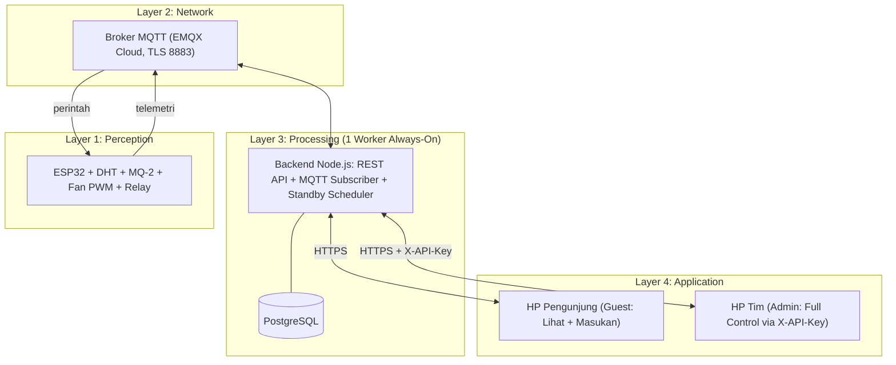

# Smart Humidity-Based Bathroom Exhaust Fan

## Lab Skenario di meja bazar

Gunakan **Panel Skenario** di HP tim untuk preset Mandi atau Asap tanpa menghasilkan uap/asap nyata. ESP32 demo memasukkan bacaan virtual ke logika kontrol asli; fan fisik tetap dikendalikan firmware. Dashboard Guest menampilkan adegan dan PWM yang dilaporkan ESP32, bukan RPM.

Fitur default mati. Aktifkan hanya pada perangkat khusus pameran (`BATHFAN_DEMO_ENABLED=1` saat build firmware, `APP_PROFILE=bazar` dan `DEMO_SCENARIOS_ENABLED=true` di backend). Lihat [runbook gladi dua HP](docs/demo-scenario-bench.md) untuk prasyarat, uji penerimaan dan rollback.

## 👥 Kontributor

| Nama | NIM |
| :--- | :--- |
| Hasan Rabbani | 123240005 |
| Ahmadsyah Anshori | 123240020 |
| Michael Bintang F.S.J | 123240145 |
| Nicolaus Narindra Lianto | 123240100 |

Proyek IoT empat layer: exhaust fan kamar mandi yang menyala otomatis berdasarkan kelembapan udara dan deteksi asap (MQ-2), bisa dipantau dan dikendalikan dari aplikasi Android, serta menyimpan riwayat data untuk ditampilkan sebagai grafik.

> **Status saat ini:** Tahap 0 sampai 8 inti selesai (termasuk sensor asap MQ-2, pemisahan akses Guest vs Admin untuk demo bazar, isolasi origin + Android Keystore, validasi TLS broker di firmware, dan pengujian otomatis). Lihat [Tahapan pengerjaan](#tahapan-pengerjaan).

---

## Daftar isi

1. [Arsitektur](#arsitektur)
2. [Fitur](#fitur)
3. [Teknologi](#teknologi)
4. [Struktur folder](#struktur-folder)
5. [Prasyarat](#prasyarat)
6. [How to Run (Lokal & Bazar)](#how-to-run-lokal--bazar)
7. [Referensi MQTT, API, & Matriks Otorisasi](#referensi-mqtt-api--matriks-otorisasi)
8. [Aturan kontrol fan](#aturan-kontrol-fan)
9. [How to Deploy (Cloud Worker vs Vercel)](#how-to-deploy-cloud-worker-vs-vercel)
10. [Runbook Bazar & Checklist Staging](#runbook-bazar--checklist-staging)
11. [Tahapan pengerjaan](#tahapan-pengerjaan)
12. [Catatan keamanan](#catatan-keamanan)
13. [Pemecahan masalah](#pemecahan-masalah)

---

## Arsitektur

| Layer | Peran | Komponen |
|---|---|---|
| 1. Perception | Membaca kelembapan, suhu, dan asap/gas, menggerakkan fan & relay | ESP32, sensor DHT, sensor MQ-2, fan 4-pin PWM, modul relay |
| 2. Network | Mengangkut telemetri dan perintah terenkripsi | WiFi, MQTT di atas TLS (port 8883), broker EMQX Cloud Serverless |
| 3. Processing | Menyimpan telemetri, melayani REST API, penjadwal Standby | Backend Node.js (`index.js`, `api.js`, `scheduler.js`), PostgreSQL |
| 4. Application | Menampilkan data *real-time*, grafik, masukan pengunjung, dan kontrol Admin | Aplikasi Android (Flutter) |



Aplikasi **tidak** berbicara langsung dengan MQTT atau PostgreSQL; seluruh komunikasi lewat REST API backend.

## Fitur

- Pemantauan kelembapan, suhu, status sensor asap MQ-2, kecepatan fan, mode, dan status online/offline secara *real-time* (sampel >= 20 detik atau gagal refresh otomatis ditandai offline).
- Deteksi status MQ-2 bertingkat: `Belum ada data` → `Offline` → `Sensor MQ-2 tidak tersedia` (kompatibel perangkat lama) → `Pemanasan` → `Asap terdeteksi` (menampilkan status alarm dan PWM fan terpisah) → `Normal`.
- Animasi aliran udara di Dashboard mengikuti kelembapan dan kecepatan fan.
- Mode **Auto** (hysteresis + post-run), **Manual** (slider kecepatan), dan **On/Off** daya (khusus Admin).
- Grafik riwayat kelembapan, kecepatan fan, dan delta asap MQ-2 (mendukung nilai negatif + penanda bucket `BOOL_OR(smoke_alert)`) untuk rentang 1 jam, 24 jam, dan 7 hari.
- **Jadwal Standby**: penjadwal di backend (WIB) menonaktifkan fan otomatis pada jam tertentu (kecuali kelembapan >= 90 % atau ada asap).
- **Mode Pengunjung vs Admin (`APP_PROFILE=bazar` vs `real`)**:
  - `real` (default): seluruh endpoint `/api/*` wajib `X-API-Key`.
  - `bazar`: pengunjung dapat melihat Dashboard, Statistik, Jadwal, dan Pengaturan secara *read-only* serta mengirim **Masukan** tanpa login, sementara kontrol perangkat tetap terkunci di HP tim (Admin) melalui verifikasi `X-API-Key` pada `ADMIN_API_ORIGIN` HTTPS yang disimpan di Android Keystore.
- **Profil Post-Run**: bawaan `post_run_sec` otomatis **300 detik** (`real`) atau **60 detik** (`bazar`), bisa di-override via `DEFAULT_POST_RUN_SEC`.
- **Portal WiFi ESP32 (`Bathfan-Setup`)** & validasi TLS CA EMQX non-blocking di firmware.

## Teknologi

| Bagian | Teknologi |
|---|---|
| Firmware | Arduino C++ (ESP32), `WiFiClientSecure` (`setCACert`), `PubSubClient`, `ArduinoJson`, `DHT` |
| Broker | EMQX Cloud Serverless (MQTT TLS port 8883) |
| Backend | Node.js, Express 5, `mqtt`, `pg`, `dotenv`, `node:test` |
| Database | PostgreSQL |
| Aplikasi | Flutter 3.50 / Dart ^3.12 (`http`, `shared_preferences`, `flutter_secure_storage`, `flutter_test`) |

## Struktur folder

```
smart-exhaus-fan/
├── firmware/
│   └── bathfan/
│       ├── bathfan.ino            # kode ESP32 (DHT, MQ-2, PWM, relay, TLS CA)
│       ├── wifi_setup.h           # portal pengaturan WiFi AP "Bathfan-Setup"
│       └── secrets.example.h      # template kredensial + MQTT_CA_CERT
├── backend/
│   ├── index.js                   # titik masuk: validasi env, MQTT subscriber, API, scheduler
│   ├── api.js                     # REST API, otorisasi Guest/Admin, cache history, rate limiter
│   ├── config.js                  # validasi .env (APP_PROFILE, ALLOWED_DEVICES, TRUST_PROXY, dll.)
│   ├── db.js                      # pool PostgreSQL (TLS cloud/PG* lokal), skema & retensi feedback
│   ├── scheduler.js               # pemeriksa jadwal Standby (WIB) terfilter allowlist
│   ├── cek.js                     # skrip bantu melihat isi tabel telemetry
│   ├── .env.example               # contoh variabel lingkungan
│   └── test/backend.test.js       # unit & integration test backend
├── app/
│   ├── android/                   # manifest & network_security_config (release HTTPS-only)
│   ├── lib/
│   │   ├── main.dart              # Dashboard, status MQ-2, 5-tab HomeShell
│   │   ├── stats_page.dart        # grafik kelembapan/fan & MQ-2
│   │   ├── schedules_page.dart    # daftar & guard mutasi jadwal Standby
│   │   ├── schedule_form.dart     # form tambah/ubah jadwal
│   │   ├── feedback_page.dart     # tab Masukan pengunjung
│   │   ├── settings_page.dart     # alamat server, aktivasi Admin, parameter perangkat
│   │   ├── api_http.dart          # pemisah request publik vs Admin terisolasi origin
│   │   ├── constants.dart         # validasi URL, session epoch, Android Keystore storage
│   │   └── air_flow.dart          # animasi aliran udara
│   └── test/security_and_mq2_test.dart
└── docs/                          # laporan & dokumen spesifikasi/rencana
```

## Prasyarat

- Git, Node.js (LTS / v20+), PostgreSQL, Flutter SDK, Android SDK.
- Akun EMQX Cloud Serverless (port TLS `8883`) + file sertifikat CA (`emqxsl-ca.crt`).
- Perangkat ESP32 (atau Wokwi untuk uji non-TLS/simulasi) dan HP Android.

---

## How to Run (Lokal & Bazar)

### 1. Siapkan PostgreSQL

```sql
CREATE USER bathfan_app WITH PASSWORD 'password-kuat';
CREATE DATABASE bathfan OWNER bathfan_app;
```

### 2. Konfigurasi & Jalankan Backend

```powershell
cd backend
npm install
copy .env.example .env
```

Isi `backend/.env`:

| Variabel | Default | Keterangan |
|---|---|---|
| `PORT` | `3000` | Port HTTP API |
| `APP_PROFILE` | `real` | `real` (`post_run_sec` 300 dtk, seluruh `/api/*` butuh kunci) atau `bazar` (`post_run_sec` 60 dtk, rute baca & feedback terbuka) |
| `DEFAULT_POST_RUN_SEC` | *(kosong)* | Override eksplisit `0..3600` detik (mengalahkan default profil) |
| `ALLOWED_DEVICES` | `fan01` | Daftar ID perangkat dipisah koma; berlaku di API, jadwal, `scheduler.js`, `syncAllConfigs`, dan MQTT subscriber |
| `TRUST_PROXY` | `0` | Mati (`0`/`false`). Di balik reverse proxy, isi tepat IP/CIDR ingress atau `loopback` (menolak `true`/`*`/angka) |
| `PUBLIC_READ_LIMIT_PER_MIN` | `120` | Batas baca publik per IP per menit pada profil `bazar` |
| `FEEDBACK_HOURLY_LIMIT` | `300` | Kuota total kiriman feedback per jam di stand |
| `MQTT_HOST`, `MQTT_PORT`, `MQTT_USER`, `MQTT_PASS`, `MQTT_CA_FILE` | - | Kredensial EMQX Cloud TLS `8883` + path CA opsional |
| `DATABASE_URL`, `DATABASE_CA_FILE` | - | URL PostgreSQL cloud (wajib TLS terverifikasi `verify-full`, menolak `disable`/`no-verify`/`prefer`/`verify-ca`/`uselibpqcompat`) atau gunakan `PGHOST`/`PGPORT`/`PGDATABASE`/`PGUSER`/`PGPASSWORD` lokal |
| `API_KEY` | *(wajib)* | Kunci Admin minimal 24 karakter (`node -e "console.log(require('crypto').randomBytes(24).toString('hex'))"`) |

Inisialisasi tabel, jalankan pengujian, lalu hidupkan backend:

```powershell
cd backend
npm test
npm run db:init
npm start
```

> **Catatan `post_run_sec`:** Nilai yang sudah tersimpan di tabel `device_config` **tidak ditimpa** saat server restart. Profil `APP_PROFILE` menentukan nilai bawaan untuk perangkat baru dan hasil saat Admin menekan tombol **Kembalikan ke bawaan** (`POST /api/config/reset`: `60` dtk pada `bazar`, `300` dtk pada `real`).

### 3. Siapkan Firmware ESP32

1. Salin `firmware/bathfan/secrets.example.h` menjadi `firmware/bathfan/secrets.h`.
2. Isi `WIFI_SSID`, `WIFI_PASS`, `MQTT_HOST`, `MQTT_USER`, `MQTT_PASS`, `SETUP_AP_PASS`, serta `MQTT_CA_CERT` (salin isi `emqxsl-ca.crt` dari konsol EMQX Cloud).
3. Flash `firmware/bathfan/bathfan.ino` ke ESP32 (untuk simulasi Wokwi, ubah `PWM_FREQ` ke `5000` dan `WiFi.begin(..., 6)`).

### 4. Jalankan & Build Aplikasi Flutter

```powershell
cd app
flutter pub get
flutter analyze
flutter test
```

- **Mode pengembangan USB (Guest baca via `adb reverse`):**
  ```powershell
  adb reverse tcp:3000 tcp:3000
  flutter run -d <id-perangkat>
  ```
  Di tab **Pengaturan**, isi alamat server ke `http://localhost:3000` (HTTP lokal hanya diizinkan pada build **debug**; kontrol Admin tetap mewajibkan HTTPS + `ADMIN_API_ORIGIN`).

- **Build APK Pengunjung (Guest murni, tanpa akses Admin):**
  ```powershell
  flutter build apk --release --dart-define=DEFAULT_BASE_URL=https://api-bazar.domain-anda.com
  ```

- **Build APK Tim (memiliki izin aktivasi Mode Admin ke satu origin tepercaya):**
  ```powershell
  flutter build apk --release `
    --dart-define=ADMIN_API_ORIGIN=https://api-bazar.domain-anda.com `
    --dart-define=DEFAULT_BASE_URL=https://api-bazar.domain-anda.com
  ```
  > Jangan pernah memasukkan `API_KEY` ke `--dart-define`. Tim memasukkan kunci Admin secara manual di tab **Pengaturan** pada HP tim saja.

---

## Referensi MQTT, API, & Matriks Otorisasi

### Topic MQTT

| Topic | Arah | Isi | Retain |
|---|---|---|---|
| `bathfan/{id}/telemetry` | ESP32 → broker | `{"hum":72.5,"temp":29.1,"pwm":65,"mode":"auto","power":true,"standby":false,"relay":true,"smoke":12,"smoke_alert":false,"smoke_ready":true,"state":"RUNNING"}` | `false` |
| `bathfan/{id}/cmd/mode` | Backend → ESP32 | `{"mode":"auto"\|"manual"}` | `false` |
| `bathfan/{id}/cmd/speed` | Backend → ESP32 | `{"pwm":0..100}` | `false` |
| `bathfan/{id}/cmd/power` | Backend → ESP32 | `{"on":true\|false}` | `false` |
| `bathfan/{id}/cmd/standby` | Backend → ESP32 | `{"active":true\|false}` | `false` |
| `bathfan/{id}/cmd/config` | Backend → ESP32 | `{"hum_on","hum_off","post_run_sec","max_pwm","smoke_on","smoke_off"}` | `true` |

### Matriks Otorisasi REST API

- Pada profil **`real` (default)**: seluruh rute `/api/*` wajib header `X-API-Key`. Hanya `GET /health` yang publik. Sesi Admin pada aplikasi Flutter membaca data terproteksi melalui wrapper `getAdmin` (`getForSession`).
- Pada profil **`bazar`**: hanya daftar metode+rute eksplisit di bawah ini yang dapat diakses Guest tanpa `X-API-Key`. Seluruh mutasi, metode lain, dan `/api/admin/verify` tetap wajib `X-API-Key` Admin. `GET /api/feedback` tidak disediakan sama sekali.

| Metode & Rute | Profil `real` | Profil `bazar` | Keterangan |
|---|---|---|---|
| `GET /health` | Publik | Publik | Respons minimal `{ ok: true }` |
| `GET /api/status` | Admin | Publik (Guest) | `smoke` dibiarkan `null` bila perangkat tidak mengirim data MQ-2 |
| `GET /api/history?range=1h\|24h\|7d` | Admin | Publik (Guest) | Cache 5 detik per `(device, range)`, agregat `smoke` memfilter `smoke_ready IS TRUE`, menyertakan `BOOL_OR(smoke_alert)` |
| `GET /api/schedules` | Admin | Publik (Guest) | Daftar jadwal Standby |
| `GET /api/config` | Admin | Publik (Guest) | Murni `SELECT` tanpa `INSERT` efek samping |
| `POST /api/feedback` | Admin | Publik (Guest) | Parser maks 16 KiB, rating 1..5, komentar 1..500, kuota 5/10mnt/IP & kuota jam stand |
| `GET /api/admin/verify` | Admin | Admin | Verifikasi kunci Admin (`200 { ok: true, role: "admin" }`) |
| `POST /api/mode`, `/speed`, `/power` | Admin | Admin | Mengirim perintah MQTT non-retained ke perangkat `ALLOWED_DEVICES` |
| `POST /api/schedules`, `PUT/DELETE /api/schedules/:id` | Admin | Admin | Mutasi dibatasi `id` dan `device_id` di dalam `ALLOWED_DEVICES` |
| `PUT /api/config`, `POST /api/config/reset` | Admin | Admin | Upsert ke DB dan publish `cmd/config` retained |
| `GET /api/feedback` | Tidak ada | Tidak ada | Ditolak `401` (Guest) / `404` (Admin) |

---

## Aturan kontrol fan

Dari prioritas tertinggi ke terendah di [bathfan.ino](file:///D:/Dev/Mobile/smart-exhaus-fan/firmware/bathfan/bathfan.ino):

1. **Daya Off**: fan mati total (`0 %`, relay terbuka).
2. **Deteksi Asap (`smokeAlert`)**: setelah masa pemanasan MQ-2 selesai (`MQ_WARMUP_MS`), jika `smokeDelta > SMOKE_ON_DELTA`, fan menyala di `MAX_PWM`; berhenti hanya setelah `smokeDelta < SMOKE_OFF_DELTA` bertahan 60 detik terus-menerus (`SMOKE_CLEAR_MS`), lalu masuk `RUNNING` atau `POSTRUN`. *(Catatan: jika sensor DHT timeout > 2 menit saat tidak di mode Manual, pengaman suhu/kelembapan di loop tetap memutus PWM menjadi 0 — aplikasi menampilkan status alarm dan PWM sebagai dua fakta terpisah.)*
3. **Standby aktif**: fan mati otomatis, **kecuali kelembapan >= 90 % (`HUM_CRITICAL`)**.
4. **Manual**: kecepatan mengikuti slider pengguna (dibatasi `MAX_PWM`).
5. **Auto**: menyala di atas `hum_on`, mati di bawah `hum_off` lalu masuk `POSTRUN`.

---

## How to Deploy (Cloud Worker vs Vercel)

### 1. Mengapa Backend Ini Tidak Bisa Dideploy Utuh ke Vercel?

**Ringkasnya:** Vercel dirancang untuk *Serverless Functions* yang hidup singkat per request HTTP dan tidur saat tidak ada trafik. Sementara itu, `backend/index.js` menjalankan **tiga tugas sekaligus dalam satu proses**:
1. **Subscriber MQTT 24/7** (`bathfan/+/telemetry`) yang harus selalu terhubung ke EMQX Cloud untuk menyimpan data sensor setiap 5 detik.
2. **Standby Scheduler (`scheduler.js`)** yang harus berjalan setiap 30 detik (dan mengirim *heartbeat* < 1 menit; jika berhenti > 3 menit, firmware keluar dari mode Standby).
3. **REST API Express (`api.js`)** dengan cache memori 5 detik dan *rate limiter* per IP.

Jika seluruh `backend/` dipaksa berjalan di Vercel Serverless:
- Koneksi MQTT dan `setInterval` scheduler mati setiap fungsi selesai/idle.
- *Rate limiter* dan cache 5 detik di memori terpecah di setiap instans serverless (*cold start*).

### 2. Arsitektur Cloud yang Direkomendasikan (1 Worker Always-On)

Deploy `backend/` sebagai **satu service Node.js yang selalu aktif (*always-on*, tepat 1 replika)** di PaaS yang mendukung proses panjang seperti **Railway**, **Render (Web Service berbayar / always-on)**, **Fly.io**, atau **VPS + PM2/systemd**, dipasangkan dengan PostgreSQL terkelola (**Neon / Supabase / Railway Postgres**):

1. Siapkan database PostgreSQL cloud (gunakan string koneksi `sslmode=verify-full` dan/atau sertifikat CA di `DATABASE_CA_FILE`).
2. Buat 1 service Node.js di host pilihan Anda dengan **Root Directory:** `backend`, **Build Command:** `npm ci`, **Start Command:** `npm start`, **Replicas:** **1** (wajib 1 agar tidak terjadi duplikasi penyimpanan telemetri dan *heartbeat* Standby ganda), **Health Check Path:** `/health`.
3. Pasang seluruh environment variable dari `backend/.env.example` (set `APP_PROFILE=bazar` untuk pameran, `API_KEY` baru khusus bazar, dan `TRUST_PROXY` sesuai IP/CIDR ingress host — jika tersedia).
4. Pastikan domain service sudah ber-HTTPS (bawaan Railway/Render/Fly.io atau Cloudflare Tunnel), lalu gunakan URL HTTPS tersebut sebagai `ADMIN_API_ORIGIN` & `DEFAULT_BASE_URL` saat build APK Flutter.

### 3. Opsi Jika Tetap Ingin Memanfaatkan Vercel

Jika Anda tetap ingin memakai Vercel dalam ekosistem proyek ini, dua pola yang valid adalah:
- **Pola A (Disarankan bila pakai Vercel) — Landing Page / QR Portal di Vercel + Backend Always-On di PaaS:**
  Gunakan Vercel untuk menghosting halaman web statis (misalnya info proyek, panduan pengunjung, dan tautan unduh APK bazar + QR code), sementara `backend/` tetap berjalan utuh sebagai 1 worker *always-on* di Railway/Render/Fly.io/VPS.
- **Pola B (Hybrid / Eksperimental) — REST API Gateway di Vercel + Worker Terpisah di PaaS:**
  Memecah `api.js` menjadi fungsi serverless (`export default app`) di Vercel tetap mengharuskan Anda menjalankan `index.js` (subscriber + scheduler) di host *always-on* terpisah, dan setiap request mutasi di Vercel harus membuat koneksi MQTTS baru lalu menutupnya (menambah latensi ~300–800 ms) serta membuat *rate limiter* in-memory tidak konsisten antar instance. Karena itu, **menjalankan seluruh `backend/` pada 1 worker always-on** adalah arsitektur paling sederhana, murah, dan stabil.

---

## Runbook Bazar & Checklist Staging

1. **Isolasi lingkungan bazar:** Gunakan database PostgreSQL, akun broker EMQX (`esp32-bazar`, `backend-bazar`), ACL publish/subscribe per perangkat (`bathfan/fan01/...`), serta `API_KEY` yang terpisah dari perangkat rumah.
2. **Build APK terpisah:**
   - APK Pengunjung: tanpa `ADMIN_API_ORIGIN` (tombol kontrol dan form Admin nonaktif).
   - APK Tim: `--dart-define=ADMIN_API_ORIGIN=https://...` (masukkan `API_KEY` di HP tim via tab **Pengaturan**).
3. **Aturan Cutover Worker:**
   - **Matikan** `node index.js` di laptop **sebelum** menyalakan worker cloud agar tidak ada dua subscriber dan dua scheduler yang menulis baris ganda atau berebut status Standby.
   - Untuk *rollback* ke laptop, matikan worker cloud terlebih dahulu sebelum menjalankan worker laptop.
4. **Checklist Uji Staging (sebelum ke stand):**
   - Uji DB baru dengan `APP_PROFILE=bazar` (`node db.js`) lalu periksa `GET /api/config` menghasilkan `post_run_sec: 60` tanpa membuat baris `INSERT`.
   - Uji mutasi `PUT/DELETE /api/schedules/:id` di DB nyata untuk memastikan jadwal milik perangkat lain di luar `ALLOWED_DEVICES` tidak terpengaruh.
   - Uji dengan dua HP melalui WiFi yang sama (NAT bersama) untuk memastikan polling Dashboard/Statistik dan pengiriman **Masukan** berjalan normal tanpa terblokir oleh kuota Guest, sedangkan mutasi tanpa kunci tetap `401`.
   - Uji pada ESP32 bahwa sertifikat `MQTT_CA_CERT` yang benar terhubung ke broker, sertifikat salah ditolak namun kontrol sensor lokal (kelembapan & asap) tetap berjalan tanpa hang, dan *reconnect* menerima `cmd/config` retained tanpa memicu perintah daya lama.
5. **Pasca-bazar:** Rotasi `API_KEY` dan bersihkan/arsipkan isi tabel `feedback` sesuai batas retensi 30 hari.

---

## Tahapan pengerjaan

Legenda: ✅ selesai, 🔄 sedang dikerjakan, ⏳ belum.

| Tahap | Isi | Status |
|---|---|---|
| 0–7 | Hardware, Wokwi, EMQX TLS, PostgreSQL, Flutter Dashboard/Statistik/Jadwal/Pengaturan | ✅ |
| 8a–8b | Autentikasi `X-API-Key`, alamat server dinamis, portal WiFi `Bathfan-Setup` | ✅ |
| 8c | Sensor asap MQ-2 (firmware, backend, grafik & status kompatibel perangkat lama), fallback lokal | ✅ |
| 8d | Pemisahan profil `real` vs `bazar`, isolasi origin + Keystore, validasi TLS broker & DB, tab Masukan | ✅ |
| 9 | Uji staging lapangan di stand & finalisasi laporan | 🔄 |

---

## Catatan keamanan

- **Jangan commit** `backend/.env`, `firmware/bathfan/secrets.h`, atau `app/android/local.properties`.
- Build rilis Android (`app/android/app/src/main/res/xml/network_security_config.xml`) menonaktifkan seluruh trafik HTTP cleartext; hanya build **debug** yang mengizinkan HTTP untuk `localhost` / IP LAN privat RFC1918, dan klien Dart menolak mengirim `X-API-Key` melalui HTTP atau redirect lintas-origin.
- Jangan aktifkan `TRUST_PROXY` secara sembarangan tanpa reverse proxy yang menimpa header `X-Forwarded-For`.

## Pemecahan masalah

| Gejala | Kemungkinan penyebab dan solusi |
|---|---|
| Status selalu Offline di HP padahal alat menyala | Pastikan hanya 1 worker backend yang aktif, atau periksa koneksi TLS + waktu NTP di Serial Monitor ESP32 |
| `Mode Admin dinonaktifkan pada build ini` | APK dibangun tanpa `--dart-define=ADMIN_API_ORIGIN=https://...` (memang ditujukan untuk APK Pengunjung) |
| Tombol `Uji koneksi` gagal di jaringan lokal pada APK rilis | Build rilis hanya mengizinkan `https://`; gunakan domain HTTPS atau jalankan build debug untuk uji `adb reverse` / LAN |
| Aplikasi menampilkan `Data MQ-2 tidak tersedia` | Perangkat menjalankan telemetri lama tanpa field `smoke`, atau data MQ-2 masih `null` |
| Firmware gagal MQTT `rc=-2` / TLS | Periksa kesesuaian `MQTT_CA_CERT` di `secrets.h` dengan sertifikat CA broker EMQX dan pastikan NTP berhasil |
