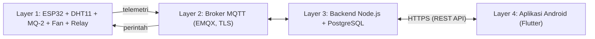

# Smart Humidity-Based Bathroom Exhaust Fan (Hembus.in)

**Tema:** Internet of Things (IoT) – Smart Home

## Deskripsi

Exhaust fan kamar mandi yang menyala otomatis berdasarkan kelembapan udara dan deteksi asap (MQ-2). Data sensor dikirim ESP32 ke backend lewat MQTT (TLS), disimpan di PostgreSQL, lalu ditampilkan di aplikasi Android sebagai data *real-time* dan grafik riwayat. Admin juga dapat mengendalikan fan dari aplikasi.

**Komponen:** ESP32, sensor DHT11, sensor MQ-2, fan PC 4-pin PWM, modul relay.

## Anggota

| Nama | NIM |
| :--- | :--- |
| Hasan Rabbani | 123240005 |
| Ahmadsyah Anshori | 123240020 |
| Michael Bintang F.S.J | 123240145 |
| Nicolaus Narindra Lianto | 123240100 |

## Arsitektur (4 Layer)

| Layer | Peran | Komponen |
| :--- | :--- | :--- |
| 1. Perception | Membaca kelembapan, suhu, dan asap; menggerakkan fan dan relay | ESP32, DHT11, MQ-2, fan PWM, relay |
| 2. Network | Mengirim telemetri dan perintah secara terenkripsi | WiFi, MQTT over TLS (port 8883), broker EMQX Cloud |
| 3. Processing | Menyimpan telemetri, melayani REST API, menjalankan penjadwal Standby | Backend Node.js (Express), PostgreSQL |
| 4. Application | Menampilkan data, grafik, dan kontrol perangkat | Aplikasi Android (Flutter) |



Aplikasi tidak terhubung langsung ke MQTT atau database, semua lewat REST API backend.

## Fitur

**Mode kontrol fan**
- **Auto:** fan menyala saat kelembapan di atas batas ON dan mati di bawah batas OFF, lalu lanjut berputar sebentar (*post-run*).
- **Manual:** kecepatan fan diatur lewat slider di aplikasi.
- **Power On/Off:** menyalakan atau mematikan fan sepenuhnya (khusus Admin).
- **Standby terjadwal:** fan dinonaktifkan pada jam tertentu (zona WIB), kecuali kelembapan ≥ 90% atau ada asap.
- **Deteksi asap (MQ-2):** saat asap terdeteksi, fan berjalan di kecepatan maksimum dan baru berhenti setelah udara bersih selama 60 detik.

**Aplikasi**
- Dashboard *real-time*: kelembapan, suhu, status MQ-2, kecepatan fan, mode, dan status online/offline.
- Grafik riwayat kelembapan dan kecepatan fan (1 jam, 24 jam, 7 hari).
- Manajemen jadwal Standby dan pengaturan parameter perangkat.
- **Demo Skenario** (Mandi/Asap) untuk simulasi tanpa asap atau uap sungguhan.

**Hak akses**
- **Pengunjung (Guest):** hanya melihat data.
- **Admin:** mengendalikan perangkat, jadwal, dan konfigurasi dengan `API_KEY`.

**Lainnya:** portal WiFi ESP32 (`Bathfan-Setup`) untuk setting jaringan tanpa mengubah kode.

## Struktur Repositori

```
├── firmware/
│   ├── bathfan/        # kode ESP32 (bathfan.ino + header pendukung)
│   └── tests/          # pengujian firmware
├── backend/            # Node.js: REST API, MQTT subscriber, scheduler
│   └── test/           # pengujian backend
├── app/                # aplikasi Android (Flutter)
│   ├── lib/
│   └── test/           # pengujian aplikasi
├── docs/               # dokumentasi pendukung
└── scripts/            # skrip build & development (PowerShell)
```

## Cara Menjalankan

**Prasyarat:** Node.js 20+, PostgreSQL, Flutter SDK, Arduino IDE/CLI (core ESP32), akun EMQX Cloud.

**1. Backend**
```bash
cd backend
npm ci
cp .env.example .env     # isi MQTT, database, dan API_KEY
npm start
npm test                 # menjalankan pengujian
```

**2. Firmware**
1. Salin `firmware/bathfan/secrets.example.h` menjadi `secrets.h`, lalu isi WiFi, MQTT, dan sertifikat CA.
2. Buka `firmware/bathfan/bathfan.ino`, lalu upload ke ESP32.

**3. Aplikasi**
```bash
cd app
flutter pub get
flutter test
flutter run --dart-define=DEFAULT_BASE_URL=http://127.0.0.1:3000
```

## Catatan

`backend/.env` dan `firmware/bathfan/secrets.h` berisi kredensial dan **tidak di-commit** (sudah ada di `.gitignore`). Gunakan berkas `*.example` sebagai templat.
